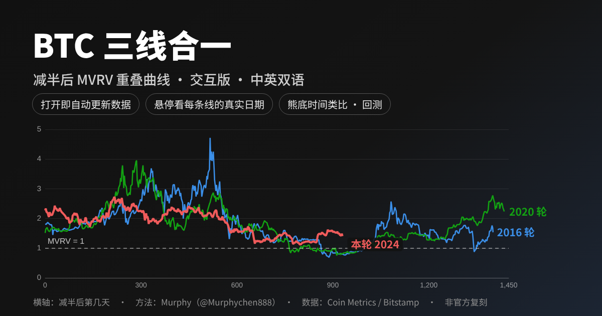

# BTC 三线合一 · BTC Three-Line Convergence

**[中文](#中文) · [English](#english)**

**在线使用 / Live：** [中文版 augustus2077.github.io/btc-sanxian](https://augustus2077.github.io/btc-sanxian/) · [English version](https://augustus2077.github.io/btc-sanxian/en.html)



---

## 中文

### 这是什么

把比特币每一轮减半之后的 **MVRV**（市值 ÷ 已实现市值 = 价格 ÷ 全网平均持币成本），按“减半日 = 第 0 天”对齐叠放在一起。这样就能看到两件事：本轮走到了历史周期的哪个阶段，以及现在比历史同期贵还是便宜。

方法来自 Murphy（[@Murphychen888](https://x.com/Murphychen888)）的“三线合一”。本项目是基于公开数据的**独立复刻与检验**，不是 Murphy 的官方作品，也不代表他的观点。

整个工具就是一个网页（单个 HTML 文件），打开就能用，手机、电脑都可以。

### 能做什么

- **主图**：本轮（红）、2020 轮（绿）、2016 轮（蓝）、2012 轮（灰）的 MVRV 按减半日对齐叠放。可以缩放、拖动；鼠标悬停能看到每条线**真实发生的日期**、MVRV、收盘价，以及按今天的已实现价格（RP）折算出的价格。另有三线合一色带、Murphy 时间窗和顶底标注。
- **全历史**：价格、已实现价格 RP 和 MVRV 的完整走势。
- **关键日期表（表一至表八）**：
  - 各轮的牛顶和熊底；
  - 每一次“三线合一”之后 90 天、180 天的回测；
  - 熊底时间类比（四种算法）；
  - 熊底前“最后一根稻草”事件落在周期的什么位置；
  - 熊底之后多久修复。

  所有数字都由页面根据数据实时计算。
- **讲透三线合一**：从 MVRV 的原理讲到每张表怎么读，再到 Murphy 判断的对错记录、方法的局限和常见问题。文中的数字随数据自动更新，可以一键打印或另存为 PDF。
- **中英双语**：右上角一键切换（English / 中文），切换后停留在同一个画面。
- **自动记住你的视图**；**“分享”**按钮可以生成当前画面的链接。

### 怎么用

- **在线**：直接打开上面的网址。每次打开都会自动从 Coin Metrics、Bitstamp 的公开接口拉取最新日线，不需要安装任何东西。
- **离线**：在“数据与更新”页点“另存为新 HTML”，会得到一个内嵌最新数据的单文件，双击就能离线打开。也可以直接下载本仓库里的 `index.html`（中文）或 `en.html`（英文）。
- **分享某个画面**：点标签栏右边的“分享”；讲解页每个小标题旁的 `#` 可以复制直达那一节的链接。

### 自己重新生成（可选）

`tools/` 文件夹是生成本页的全部源码，只需要 Python 3（不需要任何第三方库）：

```
python tools/build.py
```

这条命令会重新下载全部数据、做完整性校验，然后生成 `index.html`（中文）和 `en.html`（英文）。Windows 上也可以直接双击 `tools/更新数据.bat`。网址、版本号等设置写在 `tools/site.json` 里。

### 数据、许可与免责

- **数据来源**：
  - MVRV、每日收盘价：[Coin Metrics Community Data](https://coinmetrics.io/community-network-data/)，许可为 [CC BY-NC 4.0](https://creativecommons.org/licenses/by-nc/4.0/)，**仅限非商业使用**。
  - 盘中最高 / 最低：Bitstamp 日线公开接口。
  - 区块与减半时间：[mempool.space](https://mempool.space)。
- **图表库**：[Apache ECharts](https://echarts.apache.org) 5.6.0（Apache License 2.0）。
- **校验**：每张表的数字都用独立的 Python 程序复算并逐项核对过；与 Looknode（Glassnode 口径）逐日对比，MVRV 偏差中位数约 0.1–0.3%。
- **隐私**：页面没有统计代码、广告或 Cookie，不收集任何数据，所有计算都在你的浏览器里完成。
- **免责**：本项目只是历史数据的可视化和方法讲解，**不构成投资建议**。周期规律只有三到四个样本，统计意义有限。因为数据许可是非商业的，请勿用于商业用途。

---

## English

### What it is

Bitcoin’s **MVRV** (market cap ÷ realized cap = price ÷ the network’s average cost basis) after each halving, stacked so that halving day = day 0. This shows two things: which stage of the historical cycle we are in, and whether the market is more or less expensive than at the same point in past cycles.

The method is Murphy’s ([@Murphychen888](https://x.com/Murphychen888)) “three-line convergence” (三线合一). This project is an **independent replication and test** built on public data. It is not Murphy’s official work and does not represent his views.

The whole tool is a single web page (one HTML file) that works on phones and desktops.

### What you get

- **Main chart**: the MVRV of this cycle (red), 2020 (green), 2016 (blue) and 2012 (gray), aligned by days since the halving. You can zoom and pan; hovering shows each line’s **actual date**, MVRV, close, and the price implied by today’s realized price (RP). There is also a convergence band, Murphy’s time windows and top/bottom markers.
- **Full history**: price, realized price (RP) and MVRV over the whole history.
- **Key dates (tables 1–8)**:
  - each cycle’s top and bottom;
  - a 90- and 180-day backtest of every convergence;
  - bear-market timing analogs (four methods);
  - where the “last straw” before each bottom fell on the cycle clock;
  - how long recovery took.

  Every number is computed live.
- **Guide**: from how MVRV works to how to read every table, plus Murphy’s track record, the method’s limits and common questions. Numbers in the text update with the data, and you can print or save it as a PDF.
- **Chinese / English**: switch at the top right (English / 中文) and stay on the same view.
- **Your view is remembered automatically**, and **Share** creates a link to the exact view you are looking at.

### How to use it

- **Online**: open the link above. Every time it opens, it pulls the latest daily data from the public Coin Metrics and Bitstamp APIs. There is nothing to install.
- **Offline**: on the “Data & updates” tab, click “Save as new HTML” to get a single file with the latest data embedded, then double-click it to open it offline. You can also download `index.html` (Chinese) or `en.html` (English) from this repository.
- **Share a view**: click “Share” at the right of the tab bar, or the `#` next to any heading in the Guide.

### Rebuild it yourself (optional)

The `tools/` folder holds the complete source. It needs only Python 3 (standard library only):

```
python tools/build.py
```

This command downloads all the data, validates it and builds `index.html` (Chinese) and `en.html` (English). On Windows you can also double-click `tools/更新数据.bat` (“update data”). The site URL, version and similar settings live in `tools/site.json`.

### Data, license and disclaimer

- **Data**:
  - MVRV and daily close: [Coin Metrics Community Data](https://coinmetrics.io/community-network-data/), licensed [CC BY-NC 4.0](https://creativecommons.org/licenses/by-nc/4.0/): **non-commercial use only**.
  - Intraday high / low: Bitstamp’s public daily candles.
  - Blocks and halving times: [mempool.space](https://mempool.space).
- **Charts**: [Apache ECharts](https://echarts.apache.org) 5.6.0 (Apache License 2.0).
- **Checks**: every table was recomputed by a separate Python program and checked item by item. Compared day by day with Looknode (Glassnode data), the median MVRV difference is about 0.1–0.3%.
- **Privacy**: no analytics, ads or cookies, and no data collection. Every calculation happens in your browser.
- **Disclaimer**: this is a visualization of historical data and an explanation of a method, **not investment advice**. The cycle patterns rest on only three or four samples. Because the data license is non-commercial, please don’t use this project commercially.
